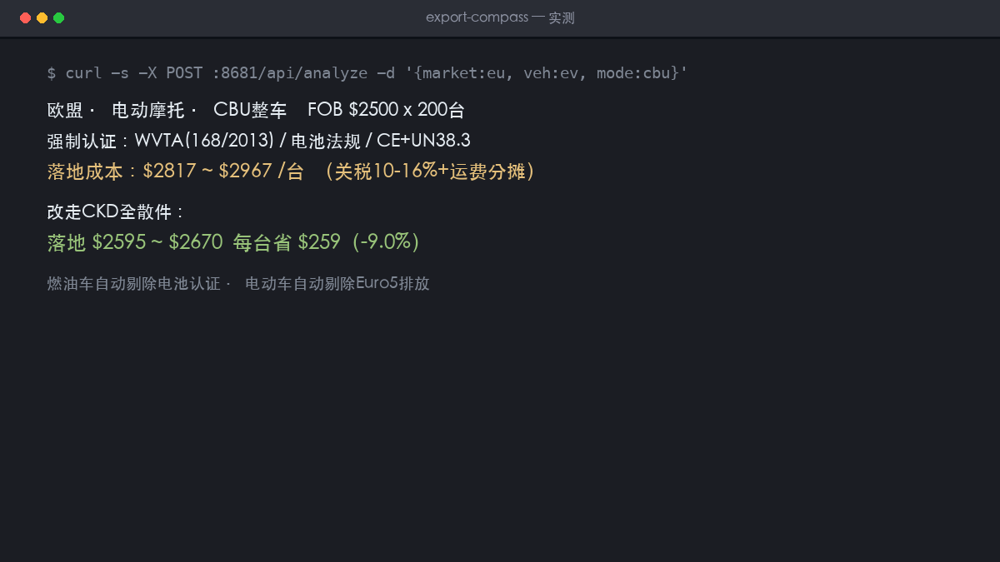

# 出海合规罗盘 ExportCompass

二轮车出口认证雷达 + CBU/SKD/CKD 落地成本测算：选目标市场，出认证差距清单与单台落地成本区间。



## 解决什么问题

- **认证黑箱**：欧盟 168/2013、美国 DOT/EPA、沙特 SABER、印尼 TKDN……每个市场一套语言，中小摩企没有专职合规团队，缺一张证海关就不放行
- **模式拍脑袋**：CBU/SKD/CKD 关税差 30 个点，单柜装载量差 4 倍，组合账没人给你算

本工具内置 8 国强制认证库（全部锚定 2025-2026 官方公开要求），按动力类型自动过滤（电动车剔除 Euro5 排放项、燃油车剔除电池项），并给出 CBU/SKD/CKD 三种模式的单台落地成本区间与省税对比；「会变的」法规动态生成「问 AI 的合规问题清单」。

## 特性

- 零依赖：纯 Python 标准库，`python3 app.py` 一条命令跑起来
- 暗色单页前端，手机浏览器直接用
- 每次生成都落盘 JSON + 可下载 Markdown 交付物

## 快速开始

```bash
python3 app.py    # http://127.0.0.1:8681
```

## 数据锚定

所有红线/认证/价格区间数据锚定 2025-2026 公开信源（官方通报、部委公告、主流媒体），页脚均有标注。信息以官方最新公告为准，本工具不构成行程/合规/维修的唯一依据。

## 免责声明

路书管规划，替代不了出发前当天的官方路况通报；合规测算为区间估算，申报以认证机构与目标国官方要求为准；病因为概率判断非确诊，安全件（刹车/轮胎/减震/ABS）以实车检修为准。

## License

MIT
